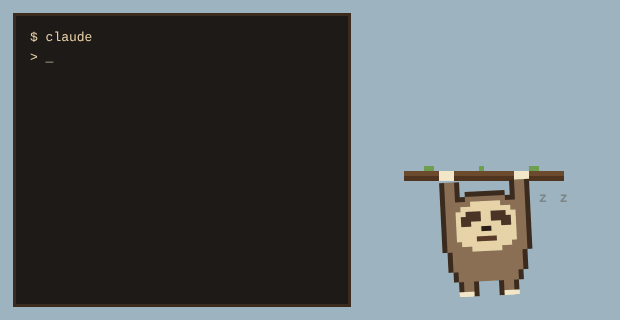
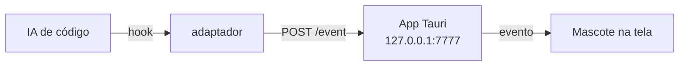

<div align="center">

# LENKO

<sub>ЛЕНКО</sub>

**Um companheiro 8-bit que avisa quando a sua IA de código terminou o trabalho.**

O LENKO vive no canto da tela, e o mascote padrão é uma preguiça. Pare de ficar olhando para o terminal esperando o agente acabar. A preguiça acorda quando você manda um prompt, pula quando a tarefa termina e balança os braços quando a IA precisa da sua aprovação.

### [⬇ Baixar o LENKO](https://dznx22.github.io/lenko/)

Windows · macOS · Linux — grátis, sem conta, poucos megabytes



**Funciona com** Claude Code · Codex · Gemini CLI · Cursor, em qualquer IDE ou terminal.

[](https://github.com/DzNx22/lenko/releases/latest)
[](https://github.com/DzNx22/lenko/actions/workflows/ci.yml)
[](LICENSE)


</div>

## Por que existe

Agentes de IA para código levam de segundos a vários minutos por tarefa. Nesse intervalo, ou você fica preso olhando o terminal, ou troca de janela e esquece de voltar. Quando a IA para no meio pedindo permissão, o tempo perdido é ainda maior.

Notificações do sistema resolvem parte do problema, mas somem e se misturam com todo o resto. O LENKO fica num canto da tela, discreto enquanto dorme, e impossível de ignorar quando tem algo para você.

## Por que LENKO?

LENKO (ЛЕНКО) une duas palavras russas: *Lenivets* (ленивец), "preguiça", e *Kompanion* (компаньон), "companheiro". É um pequeno companheiro digital, de personalidade descontraída, que fica ao seu lado no desktop e aparece quando tem algo importante a dizer.

LENKO é a identidade de um universo de personagens. A preguiça é a primeira e o mascote padrão.

## Estados

| | Quando | O que ela faz |
|---|---|---|
| 💤 **Dormindo** | Nada acontecendo | Balança devagar no galho |
| 👀 **Trabalhando** | Você enviou um prompt | Acorda e mostra o projeto |
| 🎉 **Terminei!** | A IA concluiu a tarefa | Pula, toca um som 8-bit e mostra o projeto |
| ✋ **Preciso de você** | A IA pediu aprovação | Treme e abre um balão vermelho com a pergunta |


## Instalar

1. Baixe pela **[página de download](https://dznx22.github.io/lenko/)**, que já reconhece o seu sistema. Se preferir a [página de Releases](https://github.com/DzNx22/lenko/releases/latest), estes são os arquivos de cada sistema:

   | Sistema | Arquivo |
   |---|---|
   | Windows | `LENKO_x.y.z_x64-setup.exe` |
   | macOS (Apple Silicon) | `LENKO_x.y.z_aarch64.dmg` |
   | macOS (Intel) | `LENKO_x.y.z_x64.dmg` |
   | Linux, qualquer distribuição | `LENKO_x.y.z_amd64.AppImage` |
   | Linux Debian/Ubuntu | `LENKO_x.y.z_amd64.deb` |
   | Linux Fedora | `LENKO-x.y.z-1.x86_64.rpm` |

   Os outros arquivos da Release (`.sig`, `.tar.gz`, `latest.json`) são usados pela atualização automática.
2. Instale e abra. A preguiça aparece no canto inferior direito da tela.
3. No balão "Quer que eu me conecte ao Claude Code?", clique em **Conectar** e reinicie o Claude Code.

Usa Codex, Gemini CLI ou Cursor? Clique com o botão direito no ícone da bandeja → **Conectar à IA** e marque a ferramenta.

Pronto: sem terminal e sem Node. Para desconectar depois, use o menu da bandeja.

> No Windows, enquanto o instalador não tiver assinatura digital, o SmartScreen pode mostrar "O Windows protegeu o computador". Clique em **Mais informações → Executar assim mesmo**.

O LENKO se atualiza sozinho. Quando sai uma versão nova, a preguiça avisa no balão e só instala quando você clica em **Atualizar**. Também dá para procurar na hora pelo menu da bandeja.

## Privacidade

Tudo acontece no seu computador. O LENKO não pede conta, não coleta dados e não lê o seu código: recebe apenas o tipo de evento e o nome da pasta do projeto, por um servidor que escuta só em `127.0.0.1`. A única conexão externa é a verificação de atualizações nas Releases deste repositório.

## Ferramentas suportadas

| Ferramenta | Trabalhando | Terminei | Preciso de você | Depois de conectar |
|---|:-:|:-:|:-:|---|
| Claude Code | ✓ | ✓ | ✓ | Reinicie o Claude Code. |
| Codex | ✓ | ✓ | ✓ | Aprove os hooks novos com `/hooks`. |
| Gemini CLI | ✓ | ✓ | ✓ | Reinicie o Gemini CLI. |
| Cursor | ✓ | ✓ | — | Nada: o Cursor recarrega sozinho. |

O Cursor não tem um hook para "pediu aprovação", então a preguiça não chama você nesse caso.

## Como funciona



O app não se integra a uma IDE específica, e sim à **ferramenta de IA**. Por isso funciona igual no VS Code, no JetBrains, no Cursor ou num terminal solto.

1. A ferramenta de IA dispara um *hook* em cada momento importante (prompt enviado, tarefa concluída, pedido de permissão).
2. Um adaptador transforma esse hook num evento padronizado e envia para um servidor HTTP local.
3. O app em Tauri recebe o evento e o repassa para o mascote, que muda de estado.

### Contrato de evento

Qualquer ferramenta que consiga fazer um POST pode acordar a preguiça:

```http
POST http://127.0.0.1:7777/event
Content-Type: application/json

{ "tool": "claude-code", "type": "done", "project": "meu-app", "message": "opcional" }
```

`type` aceita `working`, `done` e `waiting`. O servidor escuta apenas em `127.0.0.1`.

## Uso

Na preguiça:

- **Arraste o galho** para mover a preguiça pela tela.
- **Clique no balão ou na preguiça** para dispensar o aviso.
- **Passe o mouse por cima** para ver os botões de silenciar (♪) e fechar (×).

Na bandeja do sistema, o ícone do LENKO fica perto do relógio, na barra de tarefas. Se ele não aparecer, clique na setinha **^** para ver os ícones ocultos.

- **Clique esquerdo** no ícone mostra ou oculta a preguiça.
- **Clique direito** abre o menu:

| Opção | O que faz |
|---|---|
| **Ocultar / Mostrar** | Esconde a preguiça sem fechar o app. Como ela não aparece na barra de tarefas, é por aqui que ela volta. |
| **Silenciar sons** | Liga ou desliga os sons 8-bit. Fica sincronizado com o botão ♪ e é lembrado ao reabrir. |
| **Tamanho** | Pequeno, Médio ou Grande. Só escalas inteiras, para o pixel art continuar nítido. O canto inferior direito fica no lugar. |
| **Mascote** | Troca o mascote ou remove um que você instalou. |
| **Conectar à IA** | Marca ou desmarca cada ferramenta (Claude Code, Codex, Gemini CLI, Cursor). Adiciona ou remove só os hooks do LENKO no arquivo de configuração dela, com backup, sem mexer em hooks de terceiros. Ferramentas não encontradas no computador aparecem desabilitadas. |
| **Iniciar com o sistema** | Abre o LENKO junto com o computador. Vem desligado. |
| **Procurar atualizações** | Verifica na hora se há versão nova. A verificação automática já acontece ao abrir e a cada 6 horas. |
| **Sair** | Fecha o LENKO. |

## Mascotes

A preguiça é só o primeiro. Um mascote é um arquivo `.mascote`: um pacote com a spritesheet, o objeto onde ele se segura e, se quiser, sons próprios. Para instalar, **arraste o arquivo até o LENKO**; para trocar, use o menu **Mascote** na bandeja.

Pacotes são só dados, nunca código: o LENKO aceita uma lista fechada de arquivos, confere as imagens e recusa pacotes grandes demais. Quer criar o seu? O formato está em [docs/criar-mascote.md](docs/criar-mascote.md).

## Decisões técnicas

- **Tauri em vez de Electron.** Usa o WebView do próprio sistema, então o instalador fica com poucos megabytes em vez de mais de 100 MB, e o consumo de memória é mínimo para algo que fica aberto o dia inteiro.
- **Integração pela IA, não pela IDE.** Um único contrato HTTP desacopla o mascote das ferramentas. Suportar uma nova IA é escrever um adaptador de poucas linhas, sem tocar no app.
- **Adaptador que nunca trava a IA.** Se o app estiver fechado, o adaptador desiste em menos de um segundo e sai com sucesso. O mascote é opcional; o fluxo de trabalho não pode depender dele.
- **Instalação reversível.** O instalador de hooks marca as próprias entradas, preserva configurações de terceiros e faz backup antes de alterar qualquer arquivo.
- **Sprite como dados.** A pixel art da preguiça é desenhada como uma grade de caracteres num script que gera a spritesheet. Mudar uma expressão é editar uma linha.
- **Mascotes como pacotes seguros.** Um `.mascote` é um zip validado antes de tocar o disco: lista fechada de arquivos, limites de tamanho (inclusive contra *zip bomb*), formato e dimensões de cada imagem conferidos, instalação atômica. Nenhum script de terceiros roda no app.
- **Atualização assinada.** Cada versão é assinada, e o app só instala o que confere com a chave pública embutida. A preguiça avisa, mas nada é instalado sem o clique do usuário.
- **Um comando que roda em qualquer shell.** No Windows, cada ferramenta de IA executa o hook num shell diferente (Git Bash, PowerShell ou cmd), e um caminho com espaços entre aspas não roda no PowerShell. Para as ferramentas que usam PowerShell ou cmd, o LENKO registra o nome curto do executável (`C:/Users/FULANO~1/...`), que não tem espaços e funciona nos três.

## Limitação conhecida

Na extensão nativa do Claude Code para VS Code, o aviso de "Preciso de você" não dispara hoje ([issue #59718](https://github.com/anthropics/claude-code/issues/59718)). O "Terminei!" funciona normalmente. No Claude Code de terminal, inclusive no terminal integrado do VS Code, os três estados funcionam.

## Roadmap

- [x] Mascote com quatro estados, balão e som
- [x] Servidor local de eventos e adaptador para o Claude Code
- [x] Instalador de um clique, sem terminal, com atualização automática
- [x] Ícone na bandeja: ocultar, silenciar, tamanho, conectar/desconectar, iniciar com o sistema
- [x] Adaptadores para Codex, Gemini CLI e Cursor
- [x] Mascotes instaláveis arrastando um arquivo `.mascote`
- [ ] Vários projetos ao mesmo tempo, com fila de avisos
- [ ] Suporte a ferramentas de IA sem hooks
- [ ] Novos mascotes oficiais

## Contribuindo

Contribuições são bem-vindas, principalmente adaptadores para outras ferramentas de IA e correções de bugs. Como rodar o projeto, testar e enviar mudanças está em [CONTRIBUTING.md](CONTRIBUTING.md).

## Licença

Código-fonte sob a licença [MIT](LICENSE) © Denzell Barbosa.

O nome LENKO / ЛЕНКО, o logo, os ícones e a arte dos personagens (incluindo a preguiça) não fazem parte da MIT e têm todos os direitos reservados. Forks podem usar o código à vontade, desde que troquem o nome e o mascote. Detalhes em [TRADEMARKS.md](TRADEMARKS.md).
