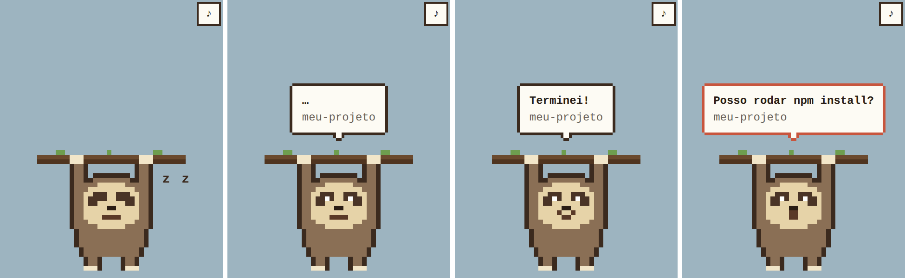
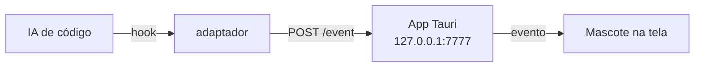

<div align="center">

# LENKO

<sub>ЛЕНКО</sub>

**Um companheiro 8-bit que avisa quando a sua IA de código terminou o trabalho.**

O LENKO vive no canto da tela, e o mascote padrão é uma preguiça. Pare de ficar olhando para o terminal esperando o agente acabar. A preguiça acorda quando você manda um prompt, pula quando a tarefa termina e balança os braços quando a IA precisa da sua aprovação.


[](LICENSE)


</div>

## Por que existe

Agentes de IA para código levam de segundos a vários minutos por tarefa. Nesse intervalo, ou você fica preso olhando o terminal, ou troca de janela e esquece de voltar. Quando a IA para no meio pedindo permissão, o tempo perdido é ainda maior.

Notificações do sistema resolvem parte do problema, mas somem e se misturam com todo o resto. O LENKO fica num canto da tela, discreto enquanto dorme, e impossível de ignorar quando tem algo para você.

## Por que LENKO?

LENKO (ЛЕНКО) une duas palavras russas: *Lenivets* (ленивец), "preguiça", e *Kompanion* (компаньон), "companheiro". É um pequeno companheiro digital, de personalidade descontraída, que fica ao seu lado no desktop e aparece quando tem algo importante a dizer.

LENKO é a identidade de um universo de personagens. A preguiça é a primeira e o mascote padrão.

## Estados

| | Quando | O que ela faz |
|---|---|---|
| 💤 **Dormindo** | Nada acontecendo | Balança devagar no galho |
| 👀 **Trabalhando** | Você enviou um prompt | Acorda e mostra o projeto |
| 🎉 **Terminei!** | A IA concluiu a tarefa | Pula, toca um som 8-bit e mostra o projeto |
| ✋ **Preciso de você** | A IA pediu aprovação | Treme e abre um balão vermelho com a pergunta |



## Como funciona



O app não se integra a uma IDE específica, e sim à **ferramenta de IA**. Por isso funciona igual no VS Code, no JetBrains, no Cursor ou num terminal solto.

1. A ferramenta de IA dispara um *hook* em cada momento importante (prompt enviado, tarefa concluída, pedido de permissão).
2. Um adaptador transforma esse hook num evento padronizado e envia para um servidor HTTP local.
3. O app em Tauri recebe o evento e o repassa para o mascote, que muda de estado.

### Contrato de evento

Qualquer ferramenta que consiga fazer um POST pode acordar a preguiça:

```http
POST http://127.0.0.1:7777/event
Content-Type: application/json

{ "tool": "claude-code", "type": "done", "project": "meu-app", "message": "opcional" }
```

`type` aceita `working`, `done` e `waiting`. O servidor escuta apenas em `127.0.0.1`.

## Rodando localmente

Pré-requisitos: [Rust](https://rustup.rs), Node.js 18+ e as [dependências do Tauri para o seu sistema](https://v2.tauri.app/start/prerequisites/).

```bash
npm install
npm run dev              # a primeira compilação demora alguns minutos
```

Com o LENKO aberto, em outro terminal:

```bash
npm run hooks:install    # conecta ao Claude Code (faz backup do settings.json)
npm run test:done        # ela deve pular e dizer "Terminei!"
```

Reinicie o Claude Code e pronto. Para desconectar: `npm run hooks:uninstall`.

> Para mexer só no visual, abra `src/index.html` no navegador e use as teclas **1–4** para simular os estados.

**Uso:** arraste o galho para mover, clique no balão para dispensar o aviso e passe o mouse por cima para silenciar ou fechar.

## Decisões técnicas

- **Tauri em vez de Electron.** Usa o WebView do próprio sistema, então o instalador fica com poucos megabytes em vez de mais de 100 MB, e o consumo de memória é mínimo para algo que fica aberto o dia inteiro.
- **Integração pela IA, não pela IDE.** Um único contrato HTTP desacopla o mascote das ferramentas. Suportar uma nova IA é escrever um adaptador de poucas linhas, sem tocar no app.
- **Adaptador que nunca trava a IA.** Se o app estiver fechado, o adaptador desiste em menos de um segundo e sai com sucesso. O mascote é opcional; o fluxo de trabalho não pode depender dele.
- **Instalação reversível.** O instalador de hooks marca as próprias entradas, preserva configurações de terceiros e faz backup antes de alterar qualquer arquivo.
- **Sprite como dados.** A pixel art é desenhada como uma grade de caracteres no código. Mudar uma expressão é editar uma linha, e isso prepara o terreno para skins.

## Limitação conhecida

Na extensão nativa do Claude Code para VS Code, o aviso de "Preciso de você" não dispara hoje ([issue #59718](https://github.com/anthropics/claude-code/issues/59718)). O "Terminei!" funciona normalmente. No Claude Code de terminal, inclusive no terminal integrado do VS Code, os três estados funcionam.

## Roadmap

- [x] Mascote com quatro estados, balão e som
- [x] Servidor local de eventos e adaptador para o Claude Code
- [ ] **Instalador de um clique:** baixar, instalar e clicar em "Conectar", sem terminal
- [ ] Atualização automática assinada
- [ ] Ícone na bandeja e opção de iniciar com o sistema
- [ ] Sistema de mascotes com pacotes `.mascote`
- [ ] Adaptadores para outras ferramentas de IA de código

## Contribuindo

Contribuições são bem-vindas, principalmente adaptadores para outras ferramentas de IA e novos mascotes originais. Abra uma *issue* descrevendo a ideia antes de começar algo grande.

## Estrutura

```
lenko/
├── src/index.html              mascote: sprite, estados, balão e som
├── src-tauri/src/main.rs       janela transparente + servidor local na porta 7777
├── src-tauri/tauri.conf.json   nome, identificador e janela do app
├── scripts/notify.js           adaptador genérico (hook → evento)
├── scripts/install-hooks.js    conecta e desconecta o Claude Code
├── docs/                       GIF e imagem dos estados usados no README
└── .github/workflows/          build dos instaladores a cada versão
```

## Licença

[MIT](LICENSE) © Denzell
